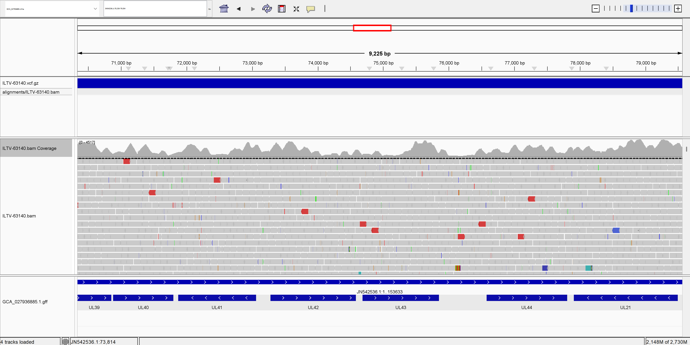
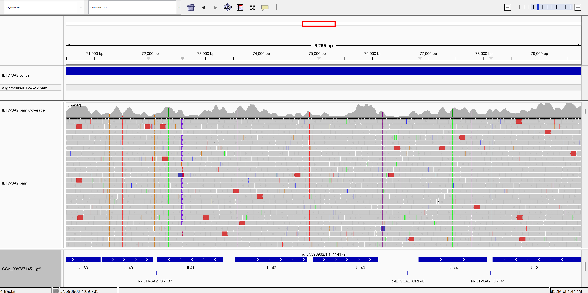
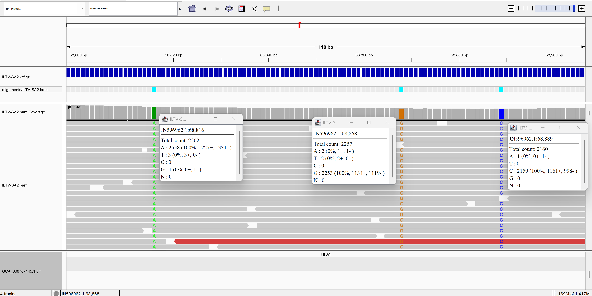

# Generating a variant call file (.vcf)
# Variant Calling for ILTV Field Isolate 63140

## Overview

This week's Makefile was updated to perform variant calling using `bcftools mpileup | bcftools call`
on **ILTV field isolate 63140** (SRR29869142 — *Gallid alphaherpesvirus 1*, paired-end WGS). Variants were called against two references:

- [Strain 63140 genome assembly (GCA_027936885.1)](https://www.ncbi.nlm.nih.gov/datasets/genome/GCA_027936885.1/) for within sample variant calling
  the reference assembled from this exact isolate (JN542536.1, 153,633 bp)
- [ILTV strain SA2 reference genome (GCF_008787145.1)](https://www.ncbi.nlm.nih.gov/datasets/genome/GCF_008787145.1/) for variant calling to another ILTV strain
  an independent NCBI reference strain for cross-strain comparison

Refer to [week05](https://github.com/DKehlbeck/BMMB852-2026/tree/main/week05) for the 
prior pipeline (download → trim → align). This week adds `variant_call` as a new target 
downstream of `align` (see below).

The Makefile was configured with `N=5,000,000` reads for this run. The coverage report lists **2,859,890 reads** and **15,548 filtered**, with **100%** of the 153.6 kbp reference covered. Mean coverage was **1.74e3x**, mean base quality **35.4**, and mean mapping quality **53.3**.

5,000,000 reads were used for mapping to acheive more uniform coverage, as lower number of reads (<30,000> achevied 10x coverage with a majoirty of the genome exisiting at <2x, and some regions having >1,000x).

## Using bcftools for variant calling

Variant calling is implemented with two primary commands
    `bcftools mpileup` computes per-site genotype likelihoods from the BAM 
    `bcftools call` uses those likelihoods to call variants.
The two commands are connected with `|` so no intermediate file is written to disk.

Two new variables are included in the [Makefile](https://github.com/DKehlbeck/BMMB852-2026/tree/main/week06/Makefile) that can be adjusted for different bcftools parameters.


```bash
# Variables for variant calling

# FORMAT/DP      per-sample depth at each site
# FORMAT/AD      per-sample allele depth (ref + alt read counts)
# FORMAT/ADF     per-sample allele depth on forward strand
# FORMAT/ADR     per-sample allele depth on reverse strand
# FORMAT/SP      per-sample strand bias p-value (Phred-scaled); redundant if using ADF/ADR
# FORMAT/SCR     per-sample soft-clip read count
# INFO/AD        allele depth summed across all samples (redundant for single-sample)
# INFO/ADF       forward-strand allele depth across all samples
# INFO/ADR       reverse-strand allele depth across all samples
# INFO/SCR       soft-clip read count across all samples
ANN := -d 500 --annotate FORMAT/DP,FORMAT/AD,FORMAT/ADF,FORMAT/ADR

# ploidy 1 is best for viral genomes
# -m is for multiallelic calling (e.g., if a site has more than one alternate allele)
CALL := --ploidy 1 -m --keep-alts --annotate FORMAT/GQ
```

bcftools mpileup utilizes the *--min-BQ 20* flag to only use reads that contain a minimum base quality of 20.

ANN caps read depth at 500x, thus A SNP or alternate allele will only appear in the VCF if at least one read carrying that base passed the base quality threshold AND was included within the 500-read depth cap at that site.

Additional flags for filtering based on read mapping quality such as *--excl-flags UNMAP,SECONDARY,QCFAIL,DUP* was investigated, but many reads contained secondary alignments, likely due to large structural repeats in the ILTV genome which dramatically reduced variant calling. Post vcf filtering for reporting will be necessary though to accurately present variant data. 

## Interpreting the Variant-Calling Results

### Mapping and coverage to ILTV-63140

| Category | Sites | % | bcftools classification | What it means |
|---|---|---|---|---|
| Total genome | 153,633 | 100% | | Complete 153,633 bp ILTV genome |
| Statistically identical | 133,115 | 86.6% | `no-ALTs` | Every read matches the reference / near zero alternate alleles exisit at this position |
| Identical with background variability | 19,493 | 12.7% | `SNP` (single alt allele) | Reference allele dominates but few reads differ with a single SNP variant |
| True minority variants | 1,025 | 0.67% | `multiallelic SNP` | Multiple distinct alternate alleles observed across reads |

At 1,740× mean coverage, 86.6% of genome positions show perfect reference agreement 
across all reads. The remaining 13.4% (20,518 sites) carry at least one read with a 
non-reference base, but the vast majority of these represent single-read observations 
at very low frequencies.

Visualization of the VCF pileup in IGV shows the read coverage and high conservation of reads to their own reference genome.



### Mapping and coverage to ILTV-SA2 (NCBI reference

## Alignment Comparison — 63140 mapped to self (JN542536.1) vs SA2 (JN596962.1)

| Metric | 63140 → 63140 (self) | 63140 → SA2 |
|---|---|---|
| Reference | 63140 (153,633 bp) | SA2 (153,024 bp) |
| Total reads | 9,647,782 | 9,649,805 |
| Primary reads | 9,647,180 | 9,647,180 |
| Supplementary alignments | 602 | 2,625 |
| Duplicates | 0 | 0 |
| Reads mapped | 2,859,890 (29.64%) | 2,860,077 (29.64%) |
| Primary mapped | 2,859,288 (29.64%) | 2,857,452 (29.62%) |
| Properly paired | 2,840,334 (29.44%) | 2,835,242 (29.39%) |
| Singletons | 15,548 (0.16%) | 16,490 (0.17%) |
| Covered bases | 153,600 bp | 152,900 bp |
| Percent covered | 100% | 99.97% |
| Mean coverage | 1,740× | 1,750× |
| Mean baseQ | 35.4 | 35.4 |
| Mean mapQ | 53.3 | 53.8 |

Mapped reads show substantial variability to SA2 reference as seen in a representative IGV view of the same genomic loci visualized above.



Interstingly the basic bcftools vcf stats do not represent this variability:

| Category | 63140 → 63140 sites | 63140 → 63140 % | 63140 → SA2 sites | 63140 → SA2 % | bcftools classification | What it means |
|---|---|---|---|---|---|---|
| Total genome | 153,633 | 100% | 152,979 | 100% | | Complete ILTV genome (63140: 153,633 bp / SA2: 153,024 bp) |
| Statistically identical | 133,115 | 86.6% | 132,300 | 86.5% | `no-ALTs` | Every read matches the reference — near zero alternate alleles at this position |
| Identical with background variability | 19,493 | 12.7% | 19,634 | 12.8% | `SNP` (single alt allele) | Reference allele dominates but few reads differ with a single alternate base |
| True minority variants | 1,025 | 0.67% | 1,041 | 0.68% | `multiallelic SNP` | Multiple distinct alternate alleles observed across reads |
| Indels | 0 | 0% | 4 | <0.01% | `indel` | Insertion or deletion relative to the reference |

Likely filtering of differences based on frequency is requiured to properly disgunishes intra/inter strain varability, as there are differences in the 63140 reads to SA2 reference seen relatively close together.



