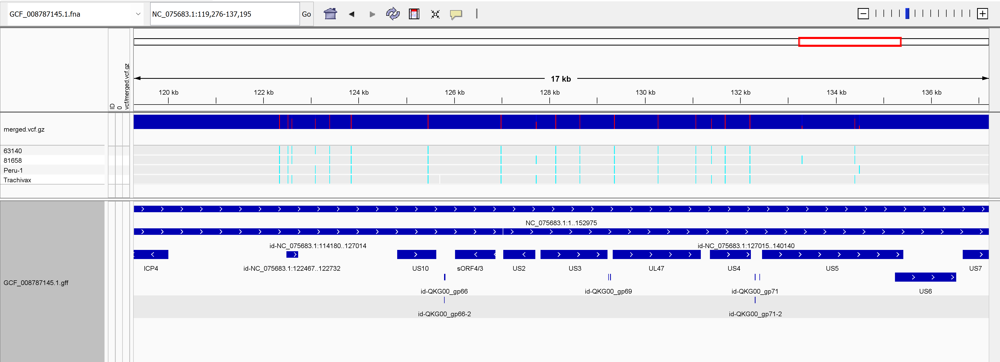
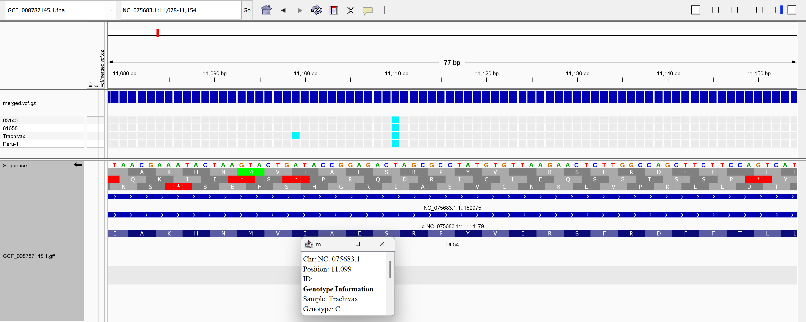
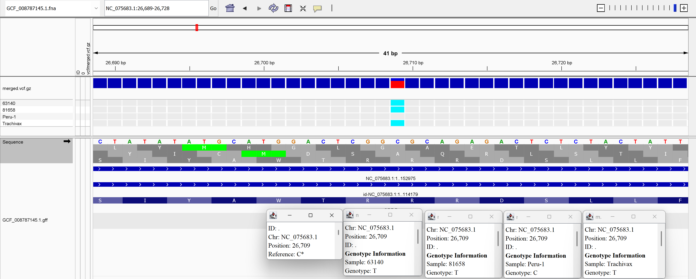

# Predicting variant effects with multiple vcf files

## Overview
This makefile takes reads from different Infectious Larotrangeitis virus (ILTV), aligns them to the NCBI reference genome "*SA2*" and calls variants for each

## Strains

**NCBI Reference:** SA2 strain — GCF_008787145.1
`https://ftp.ncbi.nlm.nih.gov/genomes/all/GCF/008/787/145/GCF_008787145.1_ASM878714v1/`
 
| Sample    | SRR           | Description          |
|-----------|---------------|----------------------|
| 63140     | SRR29869142   | Field isolate        |
| 81658     | SRR29869143   | Field isolate        |
| Trachivax | SRR29859430   | Vaccine strain       |
| Peru-1    | SRR8282614    | Field isolate        |      

## Data organization
 
```text
week08/
├── Makefile
├── README.md
├── fasta/
│   └── GCF_008787145.1.fna        # SA2 reference genome
├── gff/
│   └── GCF_008787145.1.gff        # SA2 gene annotations
├── fastq/
│   └── <sample>_R1/R2.fastq       # raw and trimmed reads
├── alignments/
│   ├── <sample>.bam                # sorted, indexed BAM
│   └── <sample>_flagstat.txt       # alignment statistics
├── vcf/
│   ├── <sample>.vcf.gz             # per-sample VCF
│   ├── merged.vcf.gz               # multi-sample VCF (4 strains)
│   └── merged_bcftools_stats.txt   # variant summary statistics
├── fastp_metrics/
│   └── <sample>_fastp.html         # trimming reports
├── NCBI_metadata/
└── SRA_metadata/
```
## Results

### Per-strain divergence from SA2

All 4 strains ahave a similar number of variants to SA2, with a variant every ~220bp. Around 80% of the variants are present in another strain. Relative to SA2 and other strains, Peru-1 appears to have the most unique variants compared to the other strains or the vaccine strain.

| Sample | Total variants | Avg. bases between variants | Shared across all 4 strains | Private variants (DP>5) |
|-----------|---------------|----------------------------|-----------------------------|-----------------------|
| 63140 | 721 | 212 bp | 550 | 21 |
| 81658 | 657 | 233 bp | 550 | 42 |
| Trachivax | 709 | 216 bp | 550 | 9 |
| Peru-1 | 680 | 225 bp | 550 | 40 |

Command to get total variants
```bash
for sample in 63140 81658 Trachivax Peru-1; do
    count=$(bcftools view -s $sample vcf/merged.vcf.gz | \
            bcftools filter -i 'GT[0]="alt" && AF>0.5' | \
            bcftools view -H | wc -l)
    echo "$sample: $count variants"
done
```

Command to get average bases between variants per strain
```bash
for sample in 63140 81658 Trachivax Peru-1; do
    avg=$(bcftools view -s $sample vcf/merged.vcf.gz | \
          bcftools filter -i 'GT[0]="alt" && AF>0.5' | \
          bcftools query -f '%POS\n' | \
          awk 'NR>1{print $1-prev} {prev=$1}' | \
          awk '{sum+=$1; n++} END {print sum/n}')
    echo "$sample: $avg bp"
done
```

Shared variants
```bash
bcftools view -i 'AC=4' vcf/merged.vcf.gz | bcftools view -H | wc -l
```

Unique variants to SA2
```bash
for sample in 63140 81658 Trachivax Peru-1; do
    count=$(bcftools view -i 'AC=1 && MIN(FORMAT/DP)>5' vcf/merged.vcf.gz | \
            bcftools view -s $sample | \
            bcftools filter -i 'GT[0]="alt"' | \
            bcftools view -H | wc -l)
    echo "$sample: $count private variants"
done
```

### IGV Visualization
The following files were loaded into IGV:
 
1. `fasta/GCF_008787145.1.fna` — SA2 reference genome
2. `gff/GCF_008787145.1.gff` — gene annotations
3. `vcf/merged.vcf.gz` — multi-sample VCF (one column per strain)
4. `alignments/<sample>.bam` — per-strain read alignments

#### Variant hotspots across the genome
 
The image below shows the distribution of variant sites across the SA2 genome, with regions of elevated variant density visible as hotspots.
 

 
---
 
#### Coding region variant — vaccine strain difference
 
The image below shows an example variant in a coding region where the Trachivax vaccine strain differs from the field isolates and reference. There is a nonsynonymous change from TCA (Serine, S) to CCA (Proline, P) in the gene UL54. UL54 encodes ICP27, a regulatory protein with potential nucleic acid binding and regulatory function ([UniProt entry](https://www.uniprot.org/uniprotkb/O89271/entry)).
 

 

 
#### Multiallelic site 
 
The image below shows a multiallelic site where a nonsynomous change is present in other strains, but not Peru-1 and SA2. SA2 and Peru-1 contian a CGC (Argenine), while the other three contain a TGC (Cysteine). This is locacted in ORF-B.
 
