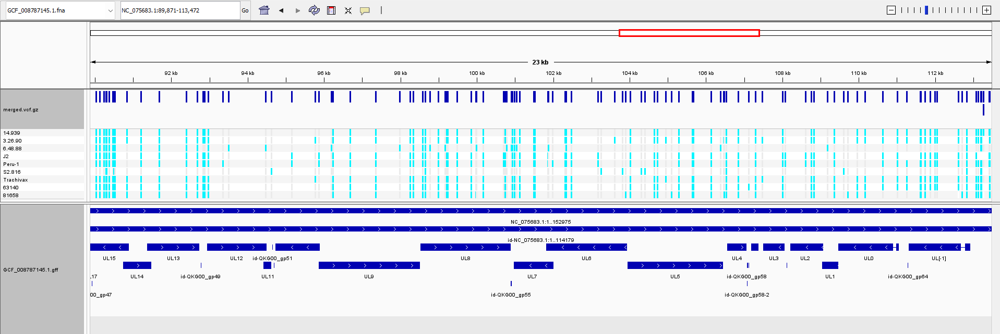

# Automating variant calling between genomes

## Overview

This is an updated script from (url:https://github.com/DKehlbeck/BMMB852-2026/blob/main/week05/Makefile) to download reads from given SRA accession numbers, map them to the NCBI reference genome and identify sites of difference. 

Updates / alterations include the use of a design.csv file to act as input for multiple accession numbers.

The currently listed design.csv will download the ILTV (Infectious Laryngeotitis Virus) NCBI reference genome, SA2 ([GCF_008787145.1](https://www.ncbi.nlm.nih.gov/datasets/genome/GCF_008787145.1/)), along with the reads associated with the BioProject: Genome sequencing of Gallid alphaherpesvirus 1 (ILTV) US field and vaccine strains ([PRJNA1136498](https://www.ncbi.nlm.nih.gov/bioproject/?term=PRJNA1136498)). 


Additionally, two other ILTV strains were included as individual SRR numbers: an additional vaccine strain ([SRR29859430](https://trace.ncbi.nlm.nih.gov/Traces/index.html?view=run_browser&acc=SRR29859430&display=metadata)) and another strain from outside of the US ([SRR8282614](https://trace.ncbi.nlm.nih.gov/Traces/index.html?view=run_browser&acc=SRR8282614&display=metadata)).

## Script execution

### Fill or append the design.csv

Design file structure is as follows with the first column representing the accession number and the second column containing the sample name, without spaces

| SRRAccession | LibraryName | AssemblyAccession | Host | Vaccination | Flock status | Country | Year | genogroup | SRAStudy | BioProject | Submission | Model | TaxID | ScientificName | Comments |
|---|---|---|---|---|---|---|---:|---:|---|---|---|---|---:|---|---|
| SRR29869143 | 81658 | JN542535 | Chicken | Non-vaccinated | Broiler | United States | 2012 | 3 | SRP520614 | PRJNA1136498 | SRA1926590 | Illumina HiSeq 2000 | 10386 | Gallid alphaherpesvirus 1 | non-vaccinated broiler (Group III) |
| SRR29869142 | 63140 | JN542536 | Chicken | NA | Broiler Breeder | United States | 2006 | 5 | SRP520614 | PRJNA1136498 | SRA1926590 | Illumina HiSeq 2000 | 10386 | Gallid alphaherpesvirus 1 | broiler breeder in Georgia (Group V) |
| SRR29869140 | 3.26.90 | MF417809 | Chicken | Non-vaccinated | Backyard | United States | 1990 | 4 | SRP520614 | PRJNA1136498 | SRA1926590 | Illumina MiSeq | 10386 | Gallid alphaherpesvirus 1 | non-vaccinated backyard chicken (Group IV) |
| SRR29869141 | 6.48.88 | MF417810 | Chicken | Non-vaccinated | Backyard | United States | 1988 | 8 | SRP520614 | PRJNA1136498 | SRA1926590 | Illumina MiSeq | 10386 | Gallid alphaherpesvirus 1 | non-vaccinated backyard chicken (Group VIII) |
| SRR29869139 | 14.939 | MF417811 | Chicken | Vaccinated | Broiler | United States | 2014 | 5 | SRP520614 | PRJNA1136498 | SRA1926590 | Illumina MiSeq | 10386 | Gallid alphaherpesvirus 1 | Recombinant LT vaccinated broiler 2014 |
| SRR29869138 | S2.816 | MF417812 | Peafowl | Non-vaccinated | Game | United States | 2002 | 7 | SRP520614 | PRJNA1136498 | SRA1926590 | Illumina MiSeq | 10386 | Gallid alphaherpesvirus 1 | Unvaccinated peafowl (Group VII) |
| SRR29869137 | J2 | MF417813 | Chicken | Non-vaccinated | Game | United States | 2008 | 6 | SRP520614 | PRJNA1136498 | SRA1926590 | Illumina MiSeq | 10386 | Gallid alphaherpesvirus 1 | Unvaccinated game chicken (Group VI) |


### Change makefile input parameters

Not included in the design file are the input parameters such as:

```bash
# N Number of reads per SRR to download
N       ?= 500000
# Adapter sequence for removal if present
ADAPTER ?= AGATCGGAAGAGCACACGTCTGAACTCCAGTCA
# Number of core threads to use for eventual mapping & variant calling
THREADS ?= 4
```

### Execution

To execute the pipeline on a single genome (Peru-1 as listed in Makefile):

```bash
make all
```

Individual stages can also be requested directly. Each stage runs its required
prerequisites first (for example, `make trim` downloads the reads if needed):

```bash
make genome    # download the reference and NCBI metadata
make sra       # download reads and save SRA metadata
make trim      # trim the reads
make index     # index the reference
make align     # align trimmed reads and create BAMs
make variants  # call per-sample variants
make merge     # create the merged multi-sample VCF
```

For information following the run on genomes included and file locations

```bash
make info
```

To use the design file run
```bash
make batch
```

To use a differnt SRR number and append those variants to the reference, use the following example
```bash
make all SRR=SRR29859430 SAMPLE_NAME=Trachivax && make merge
```

Execution of the preceding commands
```bash
make all && make batch && make all SRR=SRR29859430 SAMPLE_NAME=Trachivax && make merge
```

will yield a merged vcf which can be visualized in igv:
