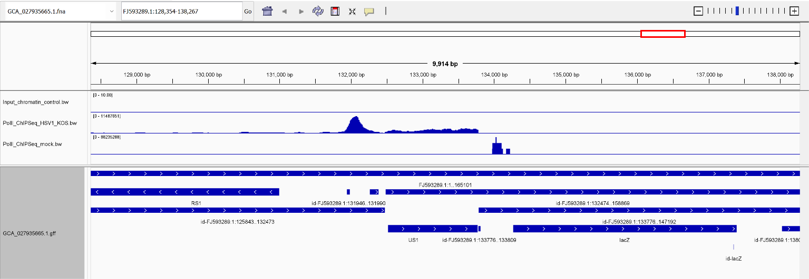
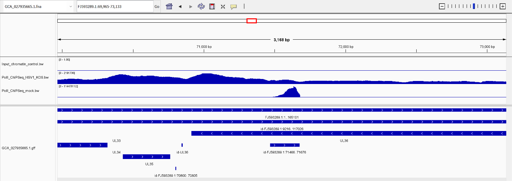
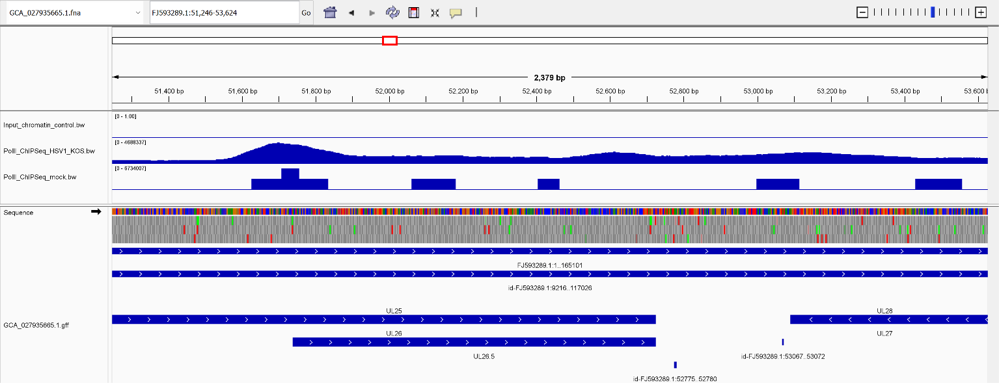

# Generating a BigWig file and calling peaks for ChIP-seq data

## Overview

This makefile will be based on a previous weeks makefile, however adapted for a different viral genome. Unfortunately, there is no avaiable Chip-seq data for the genomes used in the previous weeks (Infectious laryenteogeitis virus), or other related avian herpesviruses. 

I have found avaiable data for Human Herpes Simplexvirus type 1 (HSV1) from the following study:

[Infection by Herpes Simplex Virus 1 Causes Near-Complete Loss of RNA Polymerase II Occupancy on the Host Cell Genome](https://journals.asm.org/doi/10.1128/jvi.02665-15)

## Experimental Design
The study analyzed host RNA polymerase II occupancy across the HSV1 genome following infection of NIH 3T3 mouse fibroblast cells using ChIP-seq. Specifically the KOS strain of HSV1 was used. The experiment contains 3 samples:
- Input chromatin prior to immunoprecipitation (unclear if from mock or infected sample)
- ChIP pull down of RNAII bound DNA in mock infected conditions
- ChIP pull down of RNAII bound DNA in HSV1 KOS infected conditions

Unfortunately there is no replicate read data in this dataset so identifying variability across samples is not possible. 

## Bioinformatics workflow
Coverage plots are generated and macs3 callpeak is used for peak calling.

To get info on makefile execution:
```bash
make
```

To run variant calling on KOS (genome of interest used in the study)
```bash
make all
```

To run ChIP-seq analysis on RNA-II bound DNA run:
```bash
make batch
```


## Reasoning for excluding control bam in MASC3 execution

An input bam was identified in the SRR, however no reads map (see below)

```bash
samtools flagstat alignments/Input_chromatin_control.bam
```

```bash
5000000 + 0 in total (QC-passed reads + QC-failed reads)
5000000 + 0 primary
0 + 0 secondary
0 + 0 supplementary
0 + 0 duplicates
0 + 0 primary duplicates
1 + 0 mapped (0.00% : N/A)
1 + 0 primary mapped (0.00% : N/A)
0 + 0 paired in sequencing
0 + 0 read1
0 + 0 read2
0 + 0 properly paired (N/A : N/A)
0 + 0 with itself and mate mapped
0 + 0 singletons (N/A : N/A)
0 + 0 with mate mapped to a different chr
0 + 0 with mate mapped to a different chr (mapQ>=5)
``` 

Because of this, MACS3 cannot properly account for any background input in peak calling and returns an error:

```bash
120732 reads have been read.              # Treatment
...
0 reads have been read.                   # Control
...
total tags in control: 0
tags after filtering in control: 0
...
ZeroDivisionError: float division
```

Therefore, the execution was changed to remove -c $(INPUT_BAM), and plot all chip-seq data together
```bash

```bash
$(INFECTED_PEAKS): $(INFECTED_BAM) $(INPUT_BAM)
	mkdir -p $(PEAKS_DIR)
	macs3 callpeak \
	    -t $(INFECTED_BAM) \
	    -n $(INFECTED_NAME) \
        -c $(INPUT_BAM) \
		--nomodel --broad -g $(MACS3_GENOME_SIZE) \
	    --outdir $(PEAKS_DIR)
	wc -l $(INFECTED_PEAKS)
```

## Analysis

### Number of Peaks Identified

| Sample | Condition | Number of Peaks |
|---|---|---:|
| PolII_ChIPSeq_HSV1_KOS | HSV-1 KOS infected | 36 |
| PolII_ChIPSeq_mock | Mock infected (control) | 4 |

### Strongest Peaks in the HSV-1 KOS-Infected Sample

| Peak | Start | End | Fold Enrichment |
|---|---:|---:|---:|
| Peak 30 | 131,871 | 133,762 | 2.27 |
| Peak 31 | 147,220 | 148,672 | 2.19 |
| Peak 13 | 51,530 | 53,604 | 1.69 |
| Peak 36 | 156,626 | 159,453 | 1.69 |

Image of strongest peak is directly upstream of the gene encoding US1 (ICP22 immediate early gene):



In this image there is some background peak in the mock infected sample. This may be biologically real nonspecific binding or a bioinformatic artifact. Since there is no competitive mapping to the host mouse genome, one option may be that these mouse host reads mapping to the viral genome.

The largest of those mock peaks is within a set of known repeats in the gene UL36, so this is not too surprising if there is a coverage dispariry as there theoretically should be no viral DNA in that sample.


Interstingly, there is a region around UL26/26.5 (Virion capsid scaffolding protein) which has both a peak for the KOS infected sample and the mock infected sample

