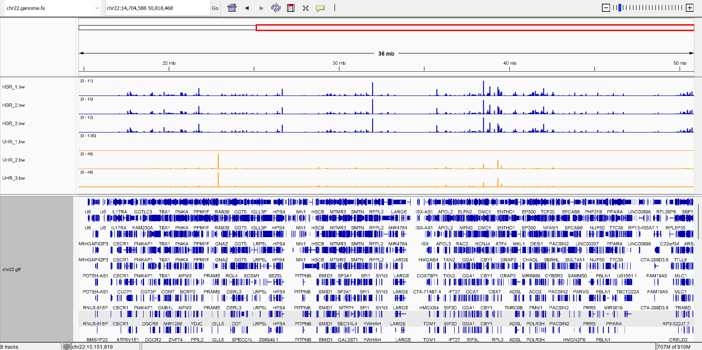
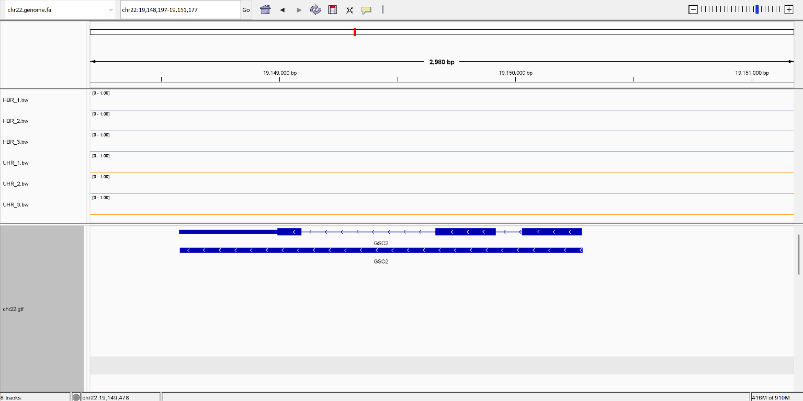
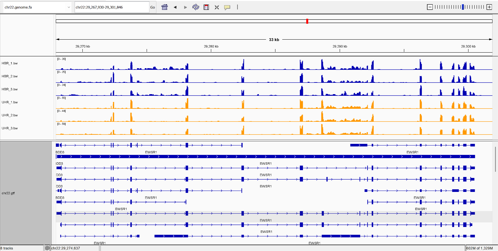
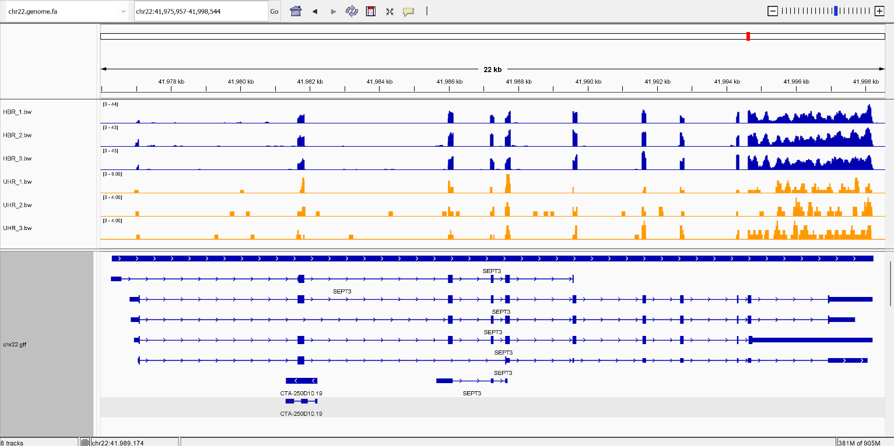
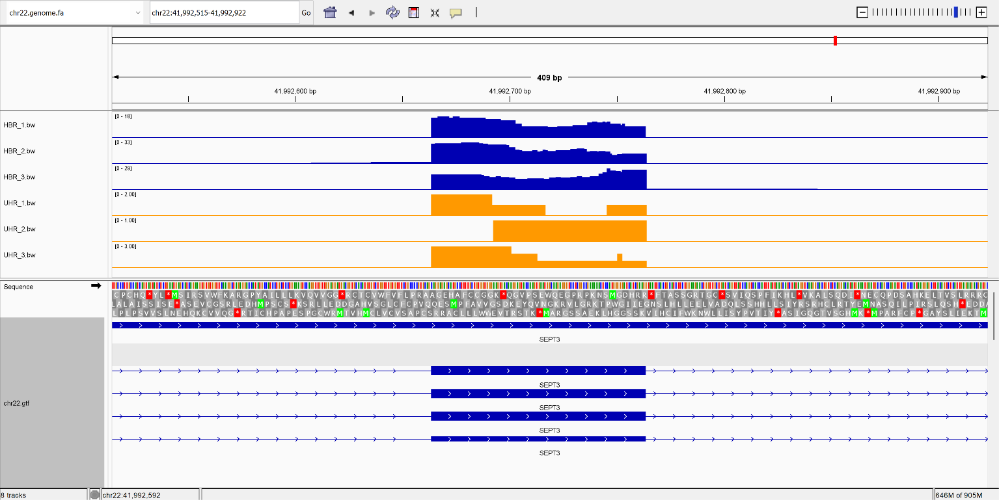

# Evaluating gene expression coverage

## Overview

The purpose of this work was to familiarize oneself with available RNA-seq data, genome alignment, read coverage visualization, and interpretation of gene expression patterns.

The data consisted of two reference transcriptomes:
- **Universal Human Reference (UHR):** Transcriptome data from 10 human cancer cell lines.
- **Human Brain Reference (HBR):** Transcriptome data from a collection of 23 brain biopsies.

Single-end sequencing reads mapping to chromosome 22 (Chr22) were downloaded for three replicate samples from each reference group. Reads were mapped to the Chr22 reference genome using a splice aware hisat2 mapper.

Read coverage was visualized using BigWig files in IGV to identify differences in gene expression, replicate consistency, transcript structure, and differential expression between the two sample types.

## Methods

Add histat2 to pixi environment for a splice-aware something or other
```bash
Pixi add histat2
```

Download the makefile used as a teaching example
```bash
curl -fsSL https://data.biostarhandbook.com/make/rnaseq.hisat.2026.mk > Makefile
```

design.csv format
```bash
sample,group
HBR_1,HBR
HBR_2,HBR
HBR_3,HBR
UHR_1,UHR
UHR_2,UHR
UHR_3,UHR
```

Run makefile to download data using

```bash
make data
```

Investigate sample information
```bash
seqkit stats fastq/*
```

```bash
processed files:  6 / 6 [======================================] ETA: 0s. done
file               format  type  num_seqs     sum_len  min_len  avg_len  max_len
fastq/HBR_1_R1.fq  FASTQ   DNA    118,571  11,857,100      100      100      100
fastq/HBR_2_R1.fq  FASTQ   DNA    144,826  14,482,600      100      100      100
fastq/HBR_3_R1.fq  FASTQ   DNA    129,786  12,978,600      100      100      100
fastq/UHR_1_R1.fq  FASTQ   DNA    227,392  22,739,200      100      100      100
fastq/UHR_2_R1.fq  FASTQ   DNA    162,373  16,237,300      100      100      100
fastq/UHR_3_R1.fq  FASTQ   DNA    185,442  18,544,200      100      100      100
```

*It should be noted that the HBR samples have only ~67% of the reads as the UHR libraries, which will affect downstream coverage information without any normalization based on read count.*

Executing the make file for all samples

```bash
make batch
```

## Questions to answer

### Wide-region comparison
Look at a wide region (millions of bases wide). How are the two sample types different?

Coverage plots for the two sample sources differ in which genes have higher coverage. Visual inspection suggests the HBR genes have greater relative coverage across Chr22 than the UHR samples. However, there are also a few very large peaks in the UHR samples with high coverage.



### Replicate consistency
Navigate across the genome. How consistent are the replicates?

Coverage is fairly consistent across replicates, with peaks following the same exons across samples at similar levels. One example is FBXO7, where peak patterns are fairly consistent across replicates; however, it does seem that for the lower-coverage samples (HBR_1), there is more variability, which may affect replicate consistency.

### Genes with no expression
Find a gene that is not expressed in any of the samples.

GSC2 is not expressed in any sample.



### Highly expressed gene
Find a gene that is very strongly expressed in all samples. What is its coverage?

EWSR1 is expressed in all samples, with coverage of ~50 for the UHR samples and ~23 for the HBR samples. When looking at the read counts for gene ID ENSG00000182944.17, we see they range from ~340-359 in the HBR replicates and 668-912 in the UHR data.



```bash
grep "ENSG00000182944" counts/*.txt
```

This read-count data follows the same trend: UHR coverage may be inflated relative to HBR due to a larger library size.

### Transcript identification
Can you identify the transcripts that are expressed? Sometimes you can only exclude some candidates.

Due to the high number of splice variants for EWSR1 (~18), it is difficult to determine which transcript feature and exon with coverage peaks is associated with one another (see above image).

One location where it is possible to identify which transcripts are potentially excluded is SEPT3. For SEPT3, in the HBR RNA-seq data we see coverage ranging from 0-43x for all samples. According to the GTF data, there are 6 splice variants of SEPT3. While we cannot accurately infer isoform information without long-read data, the exon spacing of 1-4 kb suggests that coverage data may reflect the presence of multiple splice variants.

Specifically, most exons in HBR have ~25-43x coverage, while exon 7 has ~10-30x coverage. This exon is found in only 4/6 splice variants, so the drop in coverage may be due to a greater number of longer isoform transcripts or sampling bias. What is interesting, however, is that for the SEPT3 gene the HBR samples have higher coverage here despite overall having a smaller library and fewer sequenced reads, suggesting that this may indeed be differentially upregulated in mixed human cancer cells compared with brain tissue. Although normalization to read counts and statistical enrichment would be necessary to confirm.




### Differential expression
Can you find a gene/transcript where the expression is clearly different between the two sample types? What is the fold change? Is the transcript upregulated or downregulated?

Yes, RFPL1 appears to be differentially expressed. Coverage is ~10x for HBR but 0-4x for UHR, which is hard to distinguish from noise, especially when looking at intronic regions.

Looking at the count files (last column counts):

```bash
awk '$1 ~ /ENSG00000225465/ {print FILENAME, $1, $NF}' counts/*.txt
```

We see that there are greater counts for the brain transcriptome:

```bash
counts/HBR_1.txt ENSG00000225465.8 173
counts/HBR_2.txt ENSG00000225465.8 174
counts/HBR_3.txt ENSG00000225465.8 172
counts/UHR_1.txt ENSG00000225465.8 6
counts/UHR_2.txt ENSG00000225465.8 2
counts/UHR_3.txt ENSG00000225465.8 1
```

When we calculate the fold change based on average counts:
- HBR: 173
- UHR: 3

We get a log2 fold higher expression of 5.85 for RFPL1 transcripts in the brain samples.

### Confidence in differential expression
How certain are you that it is not a random fluctuation? Why?

Firstly, the coverage varies dramatically and falls outside what standard background noise looked like across the genome. Additionally, the values are highly consistent across replicates. While no formal statistical analysis was done on this locus, this large fold increase in the brain transcriptome was observed even though the HBR samples had overall ~67% fewer reads than the UHR samples, suggesting that this *may* be a true biological difference rather than a technical artifact.
