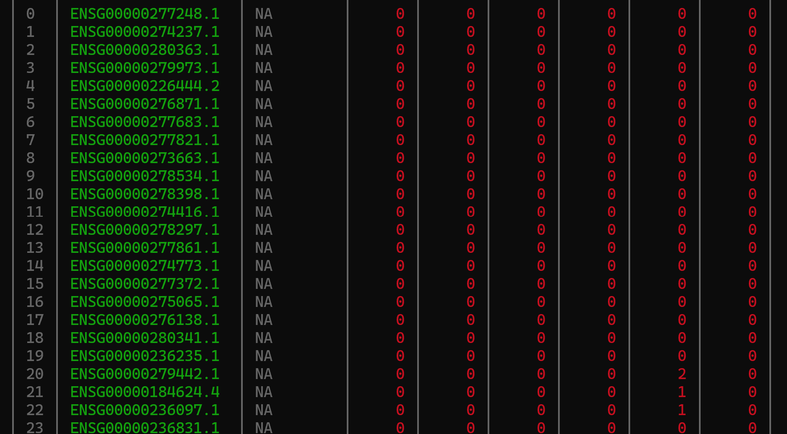
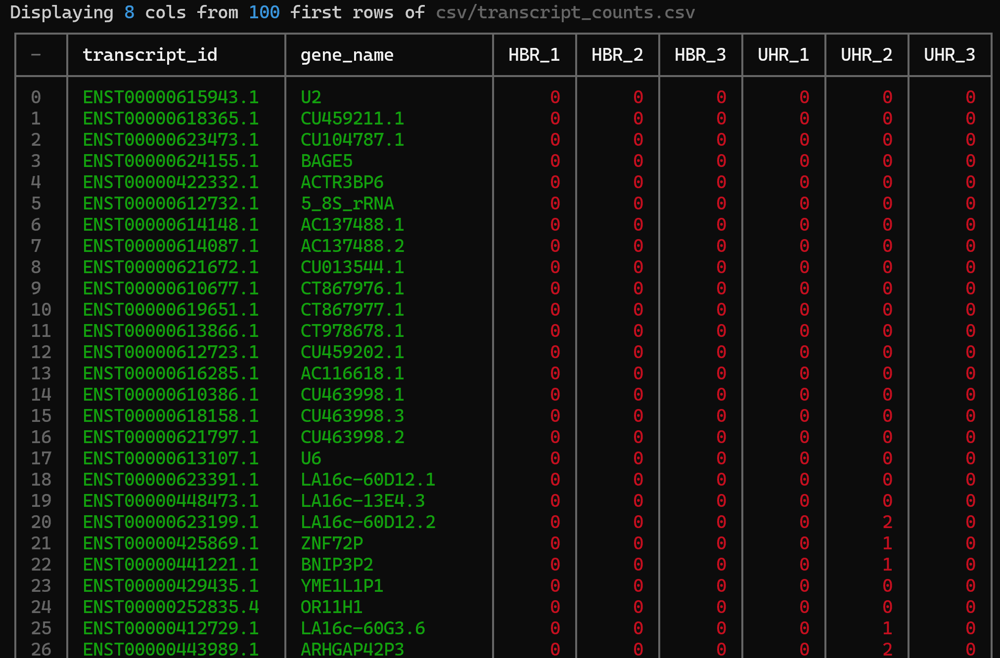
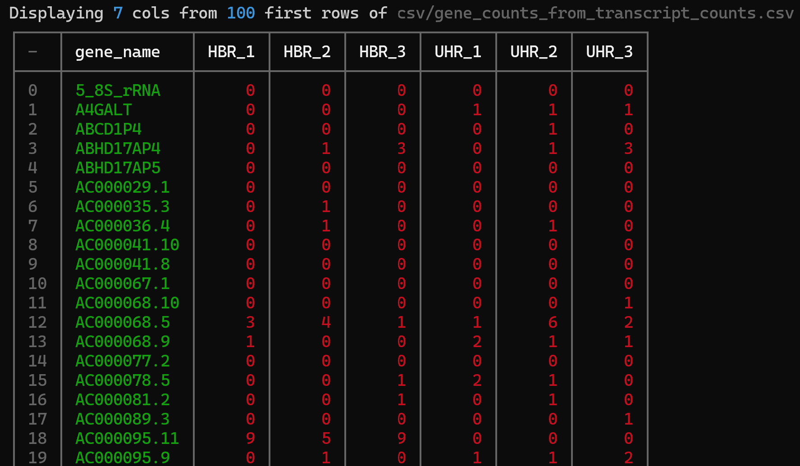

# Generating read count martrix tables using R

## Overview

The following makefile and R scripts are used to take mapped RNA seq data and individual transcript level read count information, and generate matrix tables for gene level read information.

The data consisted of two reference transcriptomes of reads mapped to human chromosme 22. Three replicates were included for each dataset:
- **Universal Human Reference (UHR):** Transcriptome data from 10 human cancer cell lines.
- **Human Brain Reference (HBR):** Transcriptome data from a collection of 23 brain biopsies.

The makefile was downloaded using 
```bash
curl -fsSL https://data.biostarhandbook.com/make/rnaseq.hisat.2026.mk > Makefile
```

The prompt to generate the R-script was:
```text
Help me write an R-script in src/combine_gene_counts.r that uses the counts directory individual sample RNAseq counts to generate a single transcript-level count matrix. These were generated using the Makefile batch target with the associated design file. Inspect each for output information (/Makefile) and sample (/design.csv) information respectively. Use the individual read count information (as a .txt tsv format in counts_transcripts/) to match the ensemble formatting ENST codes and corresponding read count. Each row should contain the gene name and ensemble ENST identifier followed by transcript counts for each individual sample. Additionally the gene name corresponding to each ENST should be used and pulled from gtf/chr22.gtf. In the finalized R-script comment out every major function explaining it input, purpose, and output.
```

### Trouble shooting a semi colon
This first pass failed to correctly identify or present the gtf gene name information:


Prompt to trouble shoot R-script:
```text
The R-script is mostly working, however the count matrix is failing to include the gene annotation names from the gtf (gtf/chr22.gtf). Before making or suggesting changes to the current gtf & gene_id fetching function, help me troubleshoot the problem. Here is the ensmble count formatting of the gtf if there is an issue in the gtf parsing in R and the .txt files: 
cchr22   ENSEMBL exon    36265151        36267530        .       +       .       gene_id "ENSG00000100342.20"; transcript_id "ENST00000422706.5"; gene_type "protein_coding"; gene_status "KNOWN"; gene_name "APOL1"; transcript_type "protein_coding"; transcript_status "KNOWN"; transcript_name "APOL1-202"; exon_number 6; exon_id "ENSE00001801451.1"; level 3; protein_id "ENSP00000411507.1"; tag "basic"; transcript_support_level "3"; tag "appris_alternative_2"; tag "CCDS"; ccdsid "CCDS13926.1"; havana_gene "OTTHUMG00000030427.8";
```

The following R console commands were suggested and used to diagnose the issue to inspectThe featureCounts output was imported into R to inspect the transcript identifiers:

The previous GTF extraction pattern was then tested against the featureCounts identifiers in counts_transcripts/HBR_1.txt:

```r
gtf_transcripts = gtf[gtf$V3 == "transcript", ]

gtf_ids = sub(
  '.*transcript_id "([^"]+)".*',
  '\\1',
  gtf_transcripts$V9
)

sum(counts$Geneid %in% gtf_ids)
```
```text
[1] 0
```
The lack of any matched identifier suggested the original character patterns to extract gene names from the gtf file was not matching the format in the individual count files as made by featureCounts.

The expression was corrected to extract the attribute value up to the next semicolon, as the semi-colon was likely the seperating value:

```r
gtf_ids = sub(
  '.*transcript_id ([^;]+);.*',
  '\\1',
  gtf_transcripts$V9
)

sum(counts$Geneid %in% gtf_ids)
```
```text
[1] 4506
```

All transcripts were now identified between R and the text file suggesting that the colon and qutation seperation was being translated differently. The (url [`read_gtf_gene_names()` function was updated, fixing the missing gene annotations.](https://github.com/DKehlbeck/BMMB852-2026/commit/fe6cdc22b28201a1ec3b85d8a4bb86d40fe9608c))

## Execution 

Run make file to obtain individual read count information
```bash
make batch
```

Activate pixi envioment to use with R script execution
```bash
pixi activate stats
```

Generate matrix file of read counts for each ENST transcript ID for each sample and confirm export
```bash
Rscript src/make_transcript_ENST_matrix.r && ls csv/
```

output
```bash
transcript_counts.csv
```

confirm transcript counts
```bash
xan view transcript_counts.csv
```



Consolidate transcript read counts under the same gene
```bash
Rscript src/combine_gene_matrix.r
```

Confirm table exists:




## Validation

Any genes that contain multiple transcipts should sum to the same values, BCL2L13 is one such gene.
The indidivual transcript level matrix based on ENST contains multiple reads for each sample in different transcript isoforms and should therefore sum together.

```bash
grep '"BCL2L13"' csv/transcript_counts.csv && grep '"BCL2L13"' csv/gene_counts_from_transcript_counts.csv
 ```
output:
```bash
"ENST00000399781.5","BCL2L13",0,0,0,0,0,0
"ENST00000399782.5","BCL2L13",0,1,0,0,0,0
"ENST00000543133.5","BCL2L13",0,0,0,0,0,0
"ENST00000611738.4","BCL2L13",0,0,0,0,0,0
"ENST00000418951.6","BCL2L13",0,0,0,0,0,0
"ENST00000616863.4","BCL2L13",0,0,0,0,0,0
"ENST00000337612.9","BCL2L13",0,0,0,0,0,0
"ENST00000618481.4","BCL2L13",0,0,0,0,0,0
"ENST00000538149.5","BCL2L13",0,0,0,0,0,0
"ENST00000317582.9","BCL2L13",0,0,0,0,0,0
"ENST00000498133.5","BCL2L13",0,0,0,0,0,0
"ENST00000464649.1","BCL2L13",0,0,0,1,0,1
"ENST00000493680.5","BCL2L13",1,5,3,4,5,3
"ENST00000355028.4","BCL2L13",0,0,0,0,0,0
"ENST00000399777.1","BCL2L13",0,0,0,0,0,0
"ENST00000479296.1","BCL2L13",0,0,0,0,0,0
"ENST00000485631.1","BCL2L13",1,0,0,2,1,0
                    
                    "BCL2L13",2,6,3,7,6,4
```
The last row represents the combined gene count level informations which sums to the correct values for each sample

To confirm whether these results are in-line with the [manual visual reporting in week 11](https://github.com/DKehlbeck/BMMB852-2026/tree/main/week11), the following genes were inspected:

### GSC2

- Expected observation:** GSC2 should not be expressed in any of the samples.
- Command:
  ```bash
  grep '"GSC2"' csv/gene_counts_from_transcript_counts.csv
  ```
- Output:
  ```text
  "GSC2",0,0,0,0,0,0
  ```

### EWSR1

- Expected observation:** EWSR1 should be similarlly expressed in both HBR and UHR samples.
- Command:
  ```bash
  grep '"EWSR1"' csv/gene_counts_from_transcript_counts.csv
  ```
- Output:
  ```text
  "EWSR1",54,29,43,55,35,41
  ```

### RFPL1S

- Expected observation: RFPL1S should show higher expression in HBR samples, with approximately 173 counts.
- Command:
  ```bash
  grep '"RFPL1S"' csv/gene_counts_from_transcript_counts.csv
  ```
- Output:
  ```text
  "RFPL1S",155,157,150,6,2,1
  ```